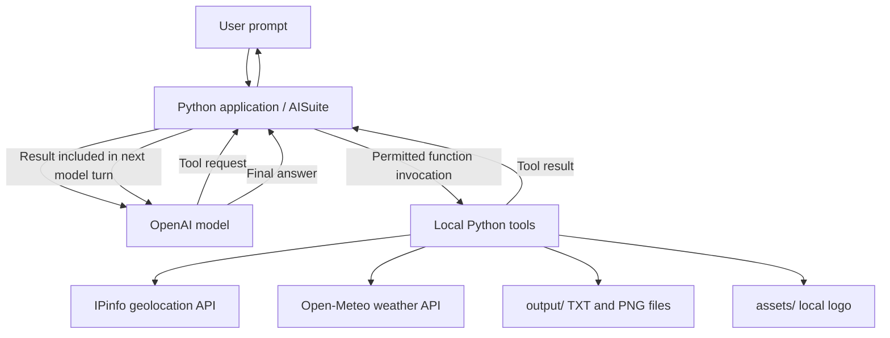
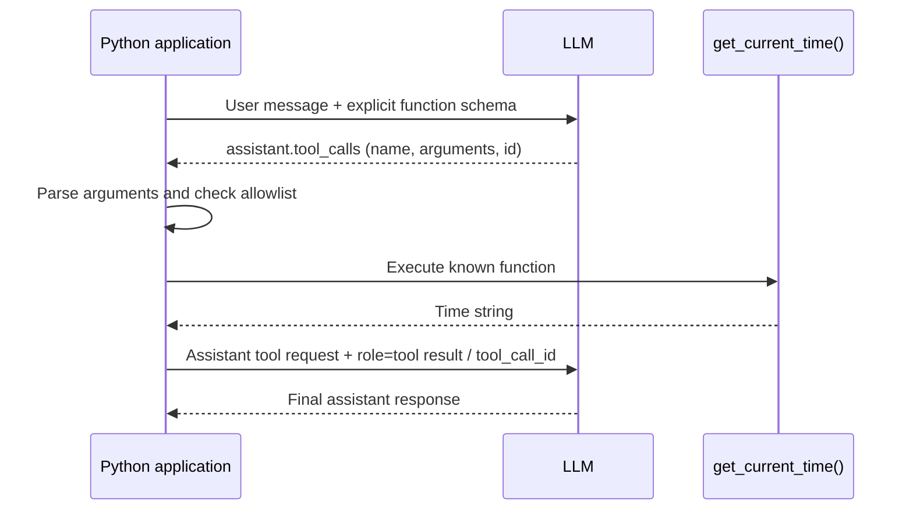
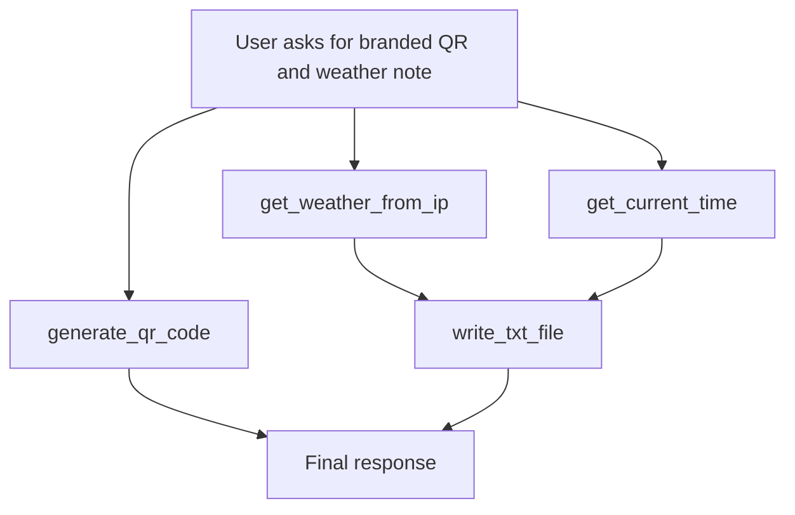

# Architecture: Functions as Tools

**Scope:** Module 3, Part 1 — a local AISuite/Python tool-use demonstration. This document describes the implemented learning architecture and distinguishes verified behavior from optional enhancements.

## 1. System context



The model **proposes a tool and arguments**. It does not get arbitrary Python execution privileges. AISuite handles execution for registered Python callables in automatic mode. The application explicitly handles execution in manual mode.

## 2. Components and responsibilities

| Component | Responsibility | Key detail |
| --- | --- | --- |
| `src/tools.py` | Tool implementations | Python functions with signatures and docstrings |
| `src/main.py` | First automatic tool call | Registers `get_current_time` |
| `src/manual_tool_call.py` | Manual protocol | Sends schema, reads requested calls, invokes allowlisted tool, submits result |
| `src/weather_agent.py` | Model-driven selection | Offers time and weather tools |
| `src/file_agent.py` | Argument generation | Lets model supply note filename and content |
| `src/qr_agent.py` | QR generation via LLM | Selects QR tool and supplies data, filename, logo |
| `src/multi_tool_agent.py` | Multi-round orchestration | Offers all four tools and uses `max_turns=10` |
| `src/tracing.py` | Optional execution instrumentation | Decorator can log local function entry, arguments, results and exceptions |
| `assets/` | Input assets | Local logo file |
| `output/` | Generated files | TXT weather notes and PNG QR images |

## 3. Automatic vs. manual calling

### Automatic mode

```python
response = client.chat.completions.create(
    model="openai:gpt-4o",
    messages=[{"role": "user", "content": "What time is it?"}],
    tools=[get_current_time],
    max_turns=5,
)
print(response.choices[0].message.content)
```

AISuite is responsible for converting callable metadata into a tool definition, executing chosen tools, forwarding results, and continuing the conversation within the turn budget.

### Manual mode



The manual version must explicitly append both the assistant's tool-call message and the tool result before the second model request. `tool_call_id` links each result to the correct request. A model-generated function name or arguments string should never be treated as a trusted command.

**Representative tool request:**

```json
{
  "role": "assistant",
  "content": null,
  "tool_calls": [{
    "id": "call_example",
    "type": "function",
    "function": {"name": "get_current_time", "arguments": "{}"}
  }]
}
```

**Representative matching result:**

```json
{"role":"tool", "tool_call_id":"call_example", "content":"14:12:27"}
```

The example values above illustrate the protocol and are not copied request IDs from a live execution.

## 4. Multi-tool dependency graph



**Dependencies:** Weather and time results must exist before writing an accurate report. QR creation is independent and may happen before, after, or in the same tool-request round as the retrieval calls. The exact actual call order should be observed rather than assumed.

Example prompt used in the local demo:

> Create a QR code linking to https://www.ratnalama.com using `lama-rock.png`; save it as `lama_multi_qr`. Also save a `weather_report.txt` containing current temperature, high, low, and the local retrieval time. Retrieve weather and time before writing the note.

Expected artifacts:

- `output/lama_multi_qr.png`
- `output/weather_report.txt`

Both were reported as created during the user's successful combined run, and the QR output was scanned successfully. The subsequent uninstrumented response did not expose its underlying sequence.

## 5. Data flow and external dependencies

### Weather

1. GET `https://ipinfo.io/json` to obtain approximate public-IP latitude and longitude.
2. GET `https://api.open-meteo.com/v1/forecast` with coordinates, `current=temperature_2m`, daily max/min, Fahrenheit units, and timezone auto.
3. Extract current, daily high, and daily low from JSON.
4. Return a formatted string to AISuite.

The local implementation adds request timeouts and HTTP status checks. It does not independently verify that IP geolocation matches the user's actual city.

### QR and file output

- `write_txt_file` uses `pathlib.Path`, validates a filename, and writes UTF-8 text inside `output/`.
- `generate_qr_code` uses `qrcode` and `StyledPilImage` for optional center-logo embedding with high error correction, loads a named asset from `assets/`, and saves a PNG inside `output/`.
- These functions create **side effects**. Running the same prompt again may overwrite earlier files.
- The Zsh `%` marker shown after `cat` output indicates missing final newline, not a literal percent character stored in the file.

## 6. Observability and tracing

### Initial experiment

The first tracing helper attempted to read intermediate tool messages from `response.messages`. The local run printed:

```text
--- Tool Execution Trace ---
Intermediate tool history is not available.
```

That result only establishes the attribute was not exposed through this access path. It does **not** mean the functions failed or that AISuite never stored their history internally.

### Optional decorator instrumentation

A `trace_tool` decorator wraps each function registered with AISuite and logs actual Python execution:

```python
from functools import wraps


def trace_tool(func):
    @wraps(func)
    def wrapper(*args, **kwargs):
        print(f"[TOOL START] {func.__name__}")
        print(f"[ARGUMENTS] args={args}, kwargs={kwargs}")
        try:
            result = func(*args, **kwargs)
            print(f"[TOOL RESULT] {result}")
            return result
        except Exception as error:
            print(f"[TOOL ERROR] {func.__name__}: {error}")
            raise
    return wrapper
```

Registration example:

```python
tools = [
    trace_tool(get_current_time),
    trace_tool(get_weather_from_ip),
    trace_tool(write_txt_file),
    trace_tool(generate_qr_code),
]
```

`functools.wraps` preserves important callable metadata for introspection. **This proposed tracing change has not yet been verified in a pasted successful terminal run.** The trace captures local invocations, not the LLM's private reasoning or necessarily every protocol-level message. Avoid logging sensitive arguments in production.

## 7. Trust boundaries and failure handling

| Risk | Current demo handling | Production extension |
| --- | --- | --- |
| Model asks for unknown function | Explicit allowlist in manual example | Central tool registry and strict schema validation |
| Model supplies untrusted filename | Writes under `output/`; checks basic filename format | Canonical-path confinement, symlink protections, size limits, overwrite policy |
| Slow/erroring weather API | HTTP timeout and `raise_for_status()` | Retries with backoff, structured error outputs and monitoring |
| Approximate location | IP-based lookup described as approximate | User-provided location or consent-based location input |
| Model loops or unnecessary tools | `max_turns` bounds AISuite workflow | Per-tool budgets, rate limits and cancellation |
| QR code is technically invalid | Scan generated image manually | Automatic decoding/validation, asset dimensions and size checks |
| Side-effectful file actions | Fixed output directory | Explicit user approval for destructive actions |
| Credentials exposed | `.env` excluded from Git | Secret manager and least-privilege credentials |

Avoid exposing arbitrary filesystem access or arbitrary function execution to an LLM. Validate at the application boundary rather than depending on instructions in the prompt alone.

## 8. Troubleshooting note: `is_mcp_config`

During manual schema-based tool registration, AISuite raised:

```text
Manual tool calling failed: name 'is_mcp_config' is not defined
```

Installing AISuite's optional MCP extras resolved the user's local error:

```bash
python -m pip install 'aisuite[mcp]'
```

The dependency declaration was updated to `aisuite[openai,mcp]` for repeatability. This is an environment/library integration issue, not evidence that the `get_current_time` function or the model's requested tool was incorrect.

## 9. Verification and next steps

**Verified in this project's learning run:** local Python execution, successful AISuite automatic time result, successful manual tool call/result loop, weather selection, file-writing, QR generation (with/without logo), QR scanning, and combined QR/weather-note creation.

**Not yet verified from supplied output:** successful decorator trace; currently passing automated tests of the final AISuite version (the original Hello World test must be revised).

Minimal next steps before marking the project fully polished:

1. Run the decorator-instrumented multi-tool agent and inspect real tool order and arguments.
2. Replace the stale Hello World test with one small offline test of file-writing validation or function formatting; do not require real API calls for routine tests.
3. Review `.gitignore` and ensure `.env`, `.venv/`, and incidental generated files are excluded.
4. If keeping sample outputs in the portfolio, explicitly select sanitized, non-secret examples rather than committing all generated files.

## 10. Attribution

The **tool-use workflow and lab exercise** are adapted from Andrew Ng's *Agentic AI* course, DeepLearning.AI: https://www.deeplearning.ai/courses/agentic-ai. The local project organization, safety constraints, command-line demonstrations, personalized QR asset, and observability experiments are additions to the educational exercise.
